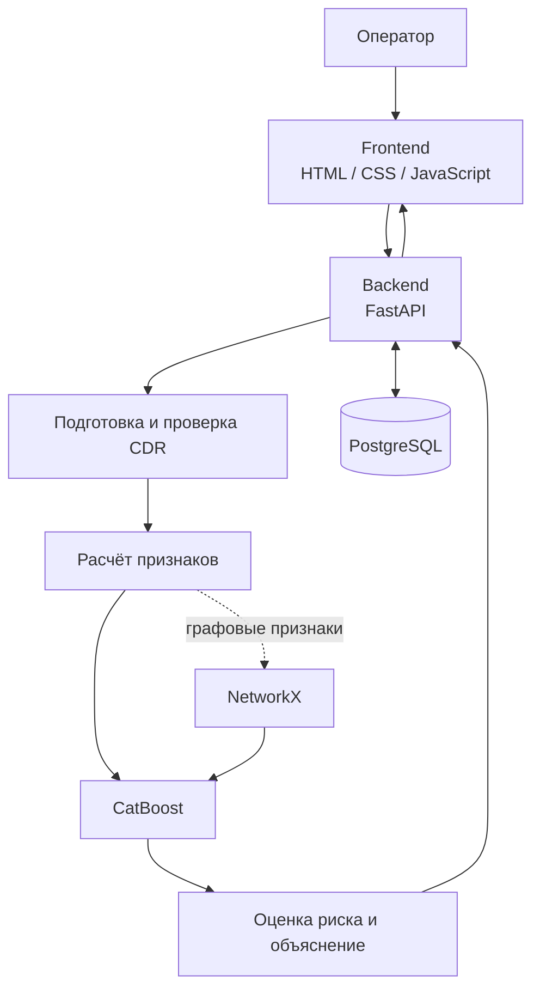
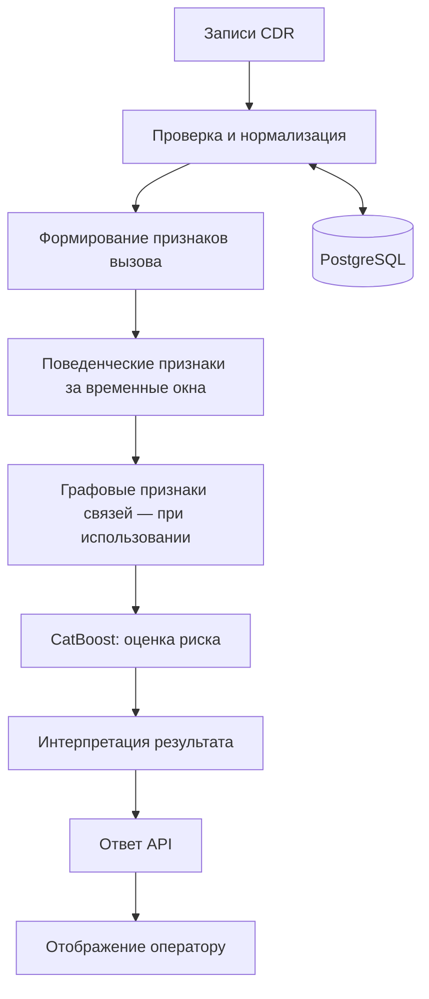

# Техническая архитектура

Документ описывает архитектуру проекта «Антифрод без прослушки» — системы скоринга телефонных вызовов по метаданным CDR для кейса Nexign «Телеком будущего».

Рабочий веб-адрес: [https://fraud-egg.onthewifi.com](https://fraud-egg.onthewifi.com)

## 1. Обзор компонентов

### Frontend

Веб-интерфейс оператора. Предназначен для просмотра сводной информации, реестра вызовов, профилей абонентов и подозрительных событий. Frontend обращается к backend по HTTP(S) и отображает полученные данные.

### Backend — FastAPI

Серверный слой приложения. Он принимает запросы интерфейса, проверяет входные данные, связывает прикладные операции с моделью и хранилищем и возвращает клиенту структурированный ответ. API служит границей между интерфейсом, ML-логикой и базой данных.

### ML-слой — CatBoost и NetworkX

- **CatBoost** — классификатор, используемый для оценки риска фрода по подготовленным признакам.
- **NetworkX** — библиотека для анализа связей между номерами и расчёта графовых признаков, если они включены в конкретный сценарий анализа.

Модель должна использовать не содержимое разговора, а метаданные вызовов и производные признаки поведения абонентов.

### PostgreSQL

PostgreSQL хранит исходные CDR, справочник операторов, результаты оценок риска, задания пакетного анализа и подготовленные представления для интерфейса.

Основные таблицы:

| Объект | Назначение и ключевые поля |
|---|---|
| `calls` | Исходные записи CDR. Первичный ключ `id` типа UUID; поля `call_type`, `imsi_a`, `msisdn_a`, `msisdn_b`, `call_time`, `duration_seconds`, `msisdn_c`. |
| `operators` | Справочник операторских префиксов: `prefix` — первичный ключ, `operator_name`, `network_type`. Допустимые типы сети: `mobile`, `landline`, `unknown`. |
| `call_risk_assessments` | История оценок риска: время оценки, имя и версия модели, `risk_score`, `risk_level`, `is_fraud`, `fraud_scenario`, `reasons`, `recommendation`, `auto_blocked` и ссылка `call_id` на `calls.id`. Для одного вызова схема допускает несколько оценок. |
| `analysis_jobs` | Задания анализа за период: `job_id`, `status`, `date_from`, `date_to`, `force_recalculate`, временные отметки, процент выполнения, JSONB-метрики и текст ошибки. |

Основные ограничения целостности:

- `calls.call_type` допускает значения `01`, `02`, `03`; `duration_seconds` не может быть отрицательной.
- `call_risk_assessments.risk_score` находится в диапазоне от `0` до `1`; `risk_level` — `low`, `medium`, `high` или `critical`.
- `fraud_scenario` может быть `NULL` либо одним из кодов `S1`–`S7`.
- `recommendation` допускает `monitor`, `manual_review`, `escalate`; `reasons` хранится в JSONB и должен быть массивом.
- `analysis_jobs.status` допускает `queued`, `running`, `completed`, `failed`, `cancelled`. Дата окончания периода не может быть раньше даты начала, а `progress_percent` ограничен диапазоном `0`–`100`.
- Для `call_risk_assessments.call_id` задан внешний ключ на `calls.id`.

Представления и кэш для чтения:

| Объект | Назначение |
|---|---|
| `calls_with_latest_assessment` | Возвращает записи CDR с последней оценкой риска для каждого вызова. |
| `fraud_alerts_view` | Формирует список подозрительных вызовов на основе `calls_with_latest_assessment`, включая риск, сценарий, причины, рекомендацию и признак автоблокировки. В представление попадают записи с `is_fraud = true` и номерами A/B, соответствующими шаблону из 10 цифр. |
| `dashboard_summary_cache` | Материализованное представление для кэширования сводной статистики. |
| `dashboard_summary_view` | Предоставляет сводные данные из `dashboard_summary_cache`. |

Для ускорения выборок предусмотрены индексы по времени вызова, номерам A/B/C, IMSI, уровню и времени оценки риска, а также по активным и недавно созданным заданиям анализа.

## 2. Поток данных: от CDR до результата

### Приём и нормализация CDR

Входная запись описывает вызов, а не его содержание. Ключевые поля:

| Поле | Назначение |
|---|---|
| `call_type` | `01` — входящий, `02` — исходящий, `03` — переадресация |
| `imsi_a` | IMSI абонента A |
| `msisdn_a` | Номер абонента A |
| `msisdn_b` | Номер второй стороны |
| `call_time` | Дата и время вызова |
| `duration_seconds` | Длительность в секундах |
| `msisdn_c` | Дополнительный номер при переадресации |

Для записей типа `03` особенно важны связи переадресации `B → C`. Нормализация номеров нужна для корректного объединения записей и сопоставления префиксов операторов.

### Подготовка признаков

Сценарии определяются поведением одного вызова и последовательностей вызовов. В зависимости от доступных данных и реализации могут использоваться следующие группы признаков:

- **Признаки вызова:** длительность, время суток, тип соединения, префикс/оператор, короткий вызов или сброс.
- **Признаки номера за временное окно:** количество вызовов, число уникальных собеседников, доля коротких и неотвеченных вызовов, активность по времени.
- **Графовые признаки:** количество связанных номеров, характер связей, массовый «веер» обзвона, цепочки или кольца переадресаций.

### Скоринг CatBoost

После формирования признакового вектора он передаётся классификатору. Результат используется как оценка риска фрода. Порог, по которому риск относят к низкому, повышенному или высокому, должен задаваться конфигурацией или логикой приложения; его конкретное значение не фиксируется в этом документе, поскольку оно зависит от текущей реализации.

Модель обучена на синтетических данных. Поэтому её результаты демонстрируют работу на подготовленных сценариях, но не являются подтверждением качества на реальном трафике оператора.

## 3. Объяснение результата оператору

Логический формат результата включает:

| Элемент | Смысл |
|---|---|
| Идентификатор и данные вызова | Позволяют найти исходную CDR-запись |
| Оценка риска | Числовой скоринг или риск в процентах — в зависимости от API |
| Уровень риска | Категория, используемая интерфейсом |
| Причины риска | Наблюдаемые факторы, например высокая частота вызовов или большое число уникальных адресатов |
| Рекомендация | Действие оператора: обычная обработка, наблюдение либо дополнительная проверка |
| Статус автоблокировки | Должен показывать, что блокировка не следует автоматически из одного скорингового значения |

## 4. Развёртывание

Корневой `docker-compose.yaml` определяет два сервиса:

- `backend` — собирается из `Backend/Dockerfile`; получает настройки из `Backend/.env`. Переменная `DB_HOST` может задаваться через `ANTIFRAUDE_DB_HOST`, по умолчанию используется `host.docker.internal`.
- `frontend` — собирается из `Frontend/Dockerfile`, зависит от `backend` и публикует порты `80` и `443` (значения можно изменить через `FRONTEND_PORT` и `FRONTEND_HTTPS_PORT`). В контейнер подключаются каталоги `/etc/letsencrypt` и `/var/lib/letsencrypt` только для чтения.

База должна быть доступна backend извне контейнеров.

## 5. Принципы безопасности и ограничения

- Анализ выполняется по метаданным CDR; аудио и транскрипции не используются.
- Скоринг является сигналом для проверки, а не автоматическим основанием для блокировки.
- Следует отдельно учитывать цену ложноположительных решений и защищать экстренные вызовы, включая 112, 101, 102, 103 и 104.
- Синтетическая обучающая выборка ограничивает выводы о качестве на реальном трафике.
- Вектор признаков и метрики модели должны версионироваться вместе с артефактом модели.
- Доступ к CDR и секретам подключения к БД должен быть ограничен; реальные значения `.env` не должны попадать в Git.